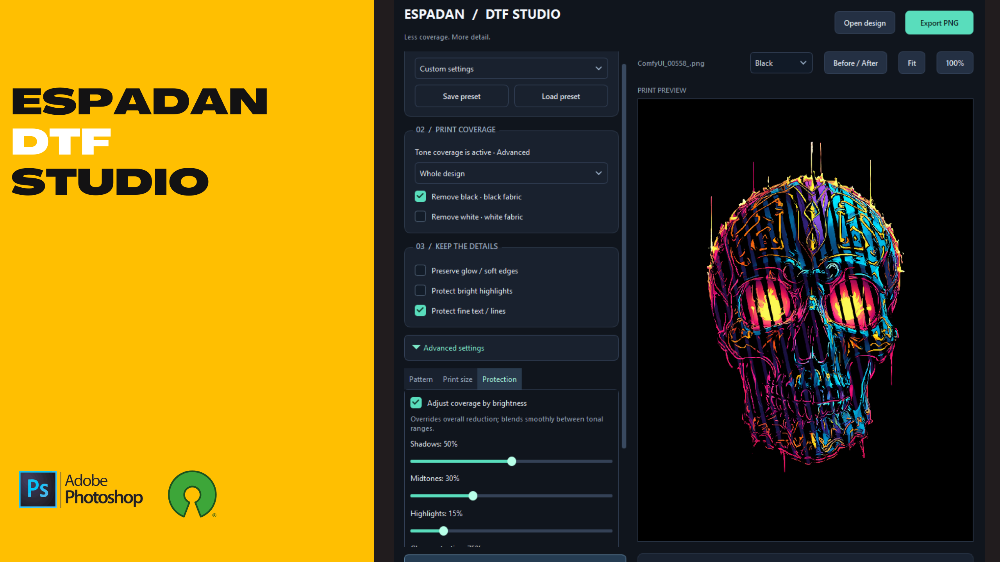

# 🖨️ Espadan DTF Studio - Pro Edition
Developed by: Iman Shirani

[](https://www.paypal.com/donate/?hosted_button_id=LAMNRY6DDWDC4)


A professional, standalone Halftone Generator meticulously designed for **Direct-to-Film (DTF)** and Screen Printing pipelines. Built with a modular architecture in Python, this tool bridges the gap between raw designs and RIP software by providing advanced rasterization, soft black knockouts, and custom halftone shapes without the need for expensive commercial plugins.

**Latest version: 0.005** — the original workflow is now extended with white knockout, selective print gaps, glow and detail protection, physical print sizing, and reusable presets.

See [CHANGELOG.md](CHANGELOG.md) for the complete changes **from 0.001 to 0.005**.


.png)


---

## ✨ Key Features

* **👻 Alpha Channel Halftoning:** Intelligently halftones only the semi-transparent areas (drop shadows, glows, smoke) while preserving solid colors. Prevents harsh edges and white ink borders in DTF printing.
* **🖤 Soft Black Knockout (Blend-If):** Automatically removes true black backgrounds and smoothly fades dark areas into the shirt's fabric, drastically improving breathability and reducing ink costs.
* **📐 Comprehensive Pattern Library:** Choose from classic mathematical shapes including `Dot`, `Line` (Vintage/Retro effect), `Square`, `Cross`, and `Diamond`.
* **💖 Custom Shape Masks:** Load any custom grayscale image (e.g., a faded heart) to use as the halftone dot matrix.
* **🛡️ Ghost-Line Prevention (Dot Gain Control):** Built-in algorithms compress the halftone screen to prevent microscopic dots from rendering in pure black/transparent areas, ensuring a flawless print.
* **🔎 Interactive Workspace:** A professional PyQt6 UI featuring real-time rendering, smooth mouse-wheel zooming, and canvas panning.

**🆕 Added in Version 0.005 (since 0.001):**

* **🤍 White Knockout:** Remove white independently for white garments, with a separate tolerance control. Black and white knockout can be configured individually.
* **🌬️ Selective Coverage Reduction:** Use `Ink reduction` to create transparent gaps even in fully opaque designs. Target the whole artwork, black areas, white areas, or both.
* **💡 Glow & Highlight Protection:** Enable `Preserve glow / soft edges` and `Protect bright highlights` to retain colored halos, soft alpha transitions, and bright reflections while reducing coverage.
* **✍️ Fine Detail Protection:** Enable `Protect fine text / lines` to protect narrow features using local contrast and geometry. Protection strength and approximate stroke width are adjustable.
* **🎚️ Tonal Coverage Controls:** Adjust reduction separately for shadows, midtones, and highlights, with smooth transitions between tonal ranges.
* **📏 Physical Print Size & LPI:** Set print width in centimeters and output DPI while preserving the aspect ratio. Use LPI for pattern density, with cell size calculated from `DPI / LPI`.
* **🌓 Preview & Comparison:** Switch between black, white, and transparent checkerboard backgrounds. Use `Before / After`, synchronized zoom and pan, `Fit`, and `100%` to inspect the result.
* **💾 Reusable Presets:** Start with black fabric, white fabric, glow/neon, or fine-line presets. Save and load your own settings as validated JSON files.
* **🧩 Simplified Pro Interface:** Keep the daily workflow focused on coverage controls and three protection checkboxes. Detailed controls are grouped under the collapsed `Advanced settings` section.
* **⚡ Background Rendering:** Cached input images, debounced setting changes, and strip-based processing keep the interface responsive. Outdated renders are interrupted, and export waits for the latest result.

**🔧 Fixes included in 0.005:** Grayscale output preserves transparency and knockout; the diamond pattern no longer disappears at some alpha levels; replacement custom masks refresh correctly; DPI and existing embedded color-profile metadata are preserved during export; missing masks and file errors are handled explicitly.

---

## 📂 Project Architecture

The application follows a strict and clean separation of concerns:

```text
espadan-dtf-studio/
│
├── main.py                 # Application entry point and signal connector
├── halftone_core.py        # Core image processing and NumPy mathematics
├── halftone_ui.py          # PyQt6 User Interface and Interactive Zoom View
├── halftone_library.py     # Mathematical definitions for pattern shapes
└── style.py                # Centralized CSS stylesheets and color themes

```
**Additional files in 0.005:**

```text
presets.py                 # Built-in presets and validated JSON settings
requirements.txt           # Python dependencies
build.ps1                  # Versioned Windows executable build script
tests/                     # Processing, preset, and UI behavior tests
CHANGELOG.md               # Cumulative changes from 0.001 to 0.005
docs/images/               # Additional screenshots for the updated README
.artifacts/                # Build intermediates and review originals
OUTPUT/build/              # Final executable releases
```

To run the current source with the existing project environment:

```powershell
.\dtf_env\Scripts\python.exe main.py
```

For a separate Python installation:

```powershell
python -m pip install -r requirements.txt
python main.py
```

To run the tests or build the current executable:

```powershell
.\dtf_env\Scripts\python.exe -B -m unittest discover -s tests -v
.\build.ps1 -Version 0.005
```

The processing base passed 19 tests. The 0.005 title, About-button visibility, and GitHub/PayPal labels and URLs were checked separately.

## 🚀 Download & Run (Standalone .exe)

The easiest way to use **Espadan DTF Studio** is to download the pre-compiled Windows executable. You do not need to install Python or any coding dependencies!

1. Go to the [Releases](https://github.com/imanshirani/Espadan-DTF-Studio/releases) page.
2. Download `ESPADAN-DTF-STUDIO.exe`.
3. Double-click the file to launch the studio and start halftoning.

**Version 0.005 executable:** The local build is available at `OUTPUT/build/ESPADAN-DTF-STUDIO-V0.005.exe`. When the corresponding release is published, choose its versioned executable from the Releases page. Earlier executable builds are retained separately.

---

### 🛡️ A Note on Antivirus & Windows Defender

Because this application is a newly compiled standalone tool (built with PyInstaller) and is not digitally signed with an expensive commercial certificate, **Windows SmartScreen** or your **Antivirus software** might flag it as an "unrecognized app" or show a false positive warning.

**This is completely normal for indie, open-source software.**

* **To run the app:** On the blue Windows SmartScreen popup, click **"More info"** and then **"Run anyway"**.
* **Security First:** Transparency is a priority. If you have any security concerns, you are highly encouraged to:
    1. Scan the `.exe` file on [VirusTotal](https://www.virustotal.com/) before running it.
    2. Or, inspect the completely open-source Python code in this repository and build the executable yourself using the developer instructions below.


🕹️ How to Use

🎥 **[Watch the Full Tutorial on YouTube](https://www.youtube.com/watch?v=J3S0TXRmVB8)**

Load Main Image: Import your high-resolution PNG or JPG design.

Tweak DTF Settings: Enable Halftone Alpha Channel for soft edges, or use Knockout Black with the tolerance slider for dark apparel.

Adjust the Grid: Select your desired shape, Pattern Size (LPI equivalent), and Angle. Use the mouse wheel on the preview window to zoom in and check for clean edges.

Export: Click Export PNG to generate a RIP-ready file with preserved transparencies.

**🆕 Version 0.005 Workflow:**

1. Click **Open design** to load a PNG, JPEG, or TIFF. EXIF orientation is applied when loading.
2. Choose a preset, or adjust **PRINT COVERAGE** manually. Use **Remove black** for black fabric or **Remove white** for white fabric. A 20–30% reduction can be a starting point for a sample print.
3. Enable the three **KEEP THE DETAILS** checkboxes as needed. For neon artwork, start with **Glow & neon**.
4. Open **Advanced settings** for the **Pattern**, **Print size**, and **Protection** tabs. Keep **Keep design colors** enabled for color artwork. Custom patterns require a valid mask; at intermediate alpha, black mask areas typically print while white or transparent areas typically become gaps.
5. To set physical dimensions, enable **Set physical print size**, enter the width and DPI, and keep the original aspect ratio. Enable **Use print density (LPI)** for cells per inch. Each cell needs at least three pixels, and resized output is limited to 60 million pixels.
6. Enable **Adjust coverage by brightness** for separate shadow, midtone, and highlight reductions. These values replace the overall reduction; the selected target still applies.
7. Use the black, white, or transparent preview backgrounds and **Before / After** to compare the design. Preview backgrounds are not included in the exported PNG.
8. Use **Save preset / Load preset** to reuse settings, then **Export PNG** when rendering finishes. Presets reference custom mask files; they do not embed the source artwork.

**Printing note:** Glow and fine-detail protection are image-based estimates, rather than text recognition or semantic segmentation. Stronger protection leaves more coverage. The displayed coverage reduction estimates mean alpha, not actual ink usage or fabric breathability. Smooth edges produces intermediate alpha; disable it if your RIP requires hard color-output halftones. The RIP must preserve transparent gaps in the white underbase. White artwork and the RIP-generated underbase are different; the application does not directly control that layer. Verify the appearance, fine lettering, stretch, and wash performance with sample prints.

**🖼️ Version 0.005 Screenshots:**

Main workspace with simple protection controls:


Before / After comparison with synchronized views:


**About / Support** remains a visible button below the settings panel, even while Advanced settings are scrolled. The window title includes **Pro Edition**; the About dialog retains the gray **GitHub** and yellow **Donate (PayPal)** buttons.


👨‍💻 Developed By
Iman Shirani | Espadan LLC Designed for creators, print shops, and the DTF community.
